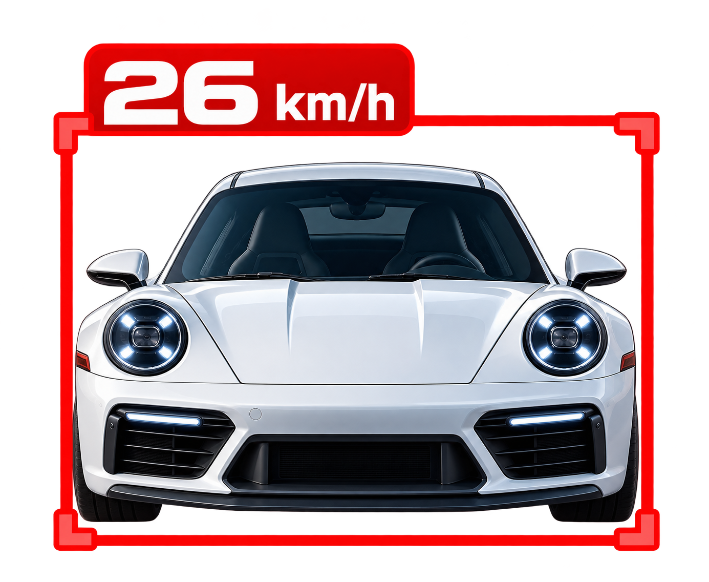
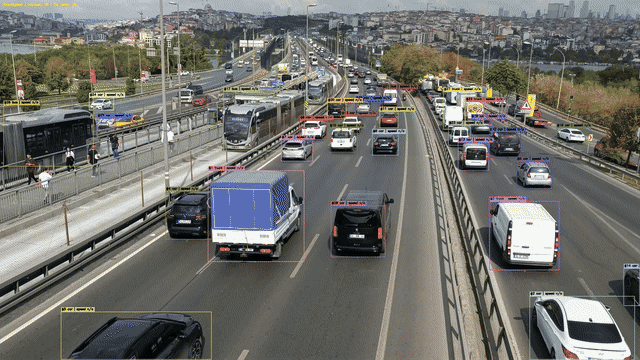

<div align="left">
  
</div>

# RoadSpeed

Detect vehicles with **YOLO11s**, follow IDs with **ByteTrack**, and estimate **km/h** using an **OpenCV road-plane homography**. Produces an annotated MP4 and a per-frame CSV. 

## Demo

Vehicle detection, tracking, and speed estimation using YOLO11, ByteTrack, and OpenCV Homography.




## Setup

Python 3.10+ recommended. Run from the project directory:

```bash
python -m venv .venv
# Windows PowerShell: .venv\Scripts\Activate.ps1
# macOS / Linux: source .venv/bin/activate
pip install -r requirements.txt
```

1. Place a fixed-camera road recording at `data/input/video.mp4` (or change `video.input` in `config.yaml`).
2. Inspect original-resolution pixel positions:
   ```bash
   python main.py inspect
   ```
   Open `outputs/calibration_frame.jpg`.
3. In `config.yaml`, replace both `null` calibration entries with **four corresponding road points**: `image_points` in video pixels, `world_points_meters` in measured meters, in identical corner order. Commented examples are templates **only**, not actual measurements.
4. Run:
   ```bash
   python main.py run
   ```

## Files

- `config.yaml` — all paths, model settings, timing, and calibration.
- `main.py` — `inspect` / `run` commands.
- `src/roadspeed/` — configuration, calibration, grid preview, and processing.
- `outputs/annotated.mp4` — detection boxes, track IDs, trails, estimated km/h.
- `outputs/tracks.csv` — timestamped tracked detections and speed estimates.
- `tests/` — calibration and video-pipeline tests.

**Notes:** Speed is available only after valid calibration and enough track history; tracks outside the calibrated road area display `speed n/a`. Real-world km/h depends on accurate road measurements, stable camera framing, correct vehicle ground-contact points, and tracking quality. One camera view needs its own calibration. To process the whole recording, set `video.max_seconds: null`. The model weights download on first use. MP4 output uses H.264 if `ffmpeg` is installed, otherwise MP4V.

Run tests with `pip install -r requirements-dev.txt` then `pytest -q`.
