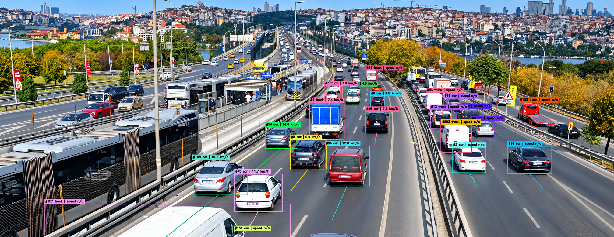

<div align="left">
  
</div>

# RoadSpeed

Detect vehicles with **YOLO11s**, follow IDs with **ByteTrack**, and estimate **km/h** using an **OpenCV road-plane homography**. Produces an annotated MP4 and a per-frame CSV. 

## Demo

Vehicle detection, tracking, and speed estimation using YOLO11, ByteTrack, and OpenCV Homography. Please see the results inside assets folder, this image is polished.



## Colab run

Add Zip folder and video.mp4 to the same directory on Google Colab and run below code: 

```python
import sys
import zipfile
import subprocess
from pathlib import Path

# Extract ZIP
extract_dir = Path("/content/roadspeed_project")

with zipfile.ZipFile("/content/DT_Speed.zip") as z:
    z.extractall(extract_dir)

project = next(
    p.parent for p in extract_dir.rglob("main.py")
    if (p.parent / "config.yaml").exists()
)

# Install dependencies
subprocess.run(
    [sys.executable, "-m", "pip", "install", "-q",
     "-r", str(project / "requirements.txt")],
    check=True
)

import yaml
import cv2

# Read video resolution
video_path = "/content/video.mp4"

cap = cv2.VideoCapture(video_path)
if not cap.isOpened():
    raise FileNotFoundError(video_path)

width = int(cap.get(cv2.CAP_PROP_FRAME_WIDTH))
height = int(cap.get(cv2.CAP_PROP_FRAME_HEIGHT))
cap.release()

# Override configuration
config_path = project / "config.yaml"

with open(config_path) as f:
    config = yaml.safe_load(f)

config["video"]["input"] = video_path

# Example calibration, scaled to actual video resolution
config["speed"]["image_points"] = [
    [round(700 * width / 1920), round(300 * height / 1080)],
    [round(1200 * width / 1920), round(300 * height / 1080)],
    [round(1500 * width / 1920), round(850 * height / 1080)],
    [round(400 * width / 1920), round(850 * height / 1080)]
]

# Assumed 7m x 20m road area — demonstration only
config["speed"]["world_points_meters"] = [
    [0, 0],
    [7, 0],
    [7, 20],
    [0, 20]
]

with open(config_path, "w") as f:
    yaml.safe_dump(config, f, sort_keys=False)

# Run detection + tracking + speed estimation
subprocess.run(
    [sys.executable, "main.py", "run"],
    cwd=project,
    check=True
)

print("Video:", project / "outputs/annotated.mp4")
print("CSV:", project / "outputs/tracks.csv")
print("NOTE: km/h values use demonstration calibration.")
```

## Setup

Python 3.10+ recommended. Run from the project directory:

```bash
python -m venv .venv
# Windows PowerShell: .venv\Scripts\Activate.ps1
# macOS / Linux: source .venv/bin/activate
pip install -r requirements.txt
```

1. Place a fixed-camera road recording at `data/input/video.mp4` (or change `video.input` in `config.yaml`).
2. Inspect original-resolution pixel positions:
   ```bash
   python main.py inspect
   ```
   Open `outputs/calibration_frame.jpg`.
3. In `config.yaml`, replace both `null` calibration entries with **four corresponding road points**: `image_points` in video pixels, `world_points_meters` in measured meters, in identical corner order. Commented examples are templates **only**, not actual measurements.
4. Run:
   ```bash
   python main.py run
   ```

## Files

- `config.yaml` — all paths, model settings, timing, and calibration.
- `main.py` — `inspect` / `run` commands.
- `src/roadspeed/` — configuration, calibration, grid preview, and processing.
- `outputs/annotated.mp4` — detection boxes, track IDs, trails, estimated km/h.
- `outputs/tracks.csv` — timestamped tracked detections and speed estimates.
- `tests/` — calibration and video-pipeline tests.

**Notes:** Speed is available only after valid calibration and enough track history; tracks outside the calibrated road area display `speed n/a`. Real-world km/h depends on accurate road measurements, stable camera framing, correct vehicle ground-contact points, and tracking quality. One camera view needs its own calibration. To process the whole recording, set `video.max_seconds: null`. The model weights download on first use. MP4 output uses H.264 if `ffmpeg` is installed, otherwise MP4V.

Run tests with `pip install -r requirements-dev.txt` then `pytest -q`.
